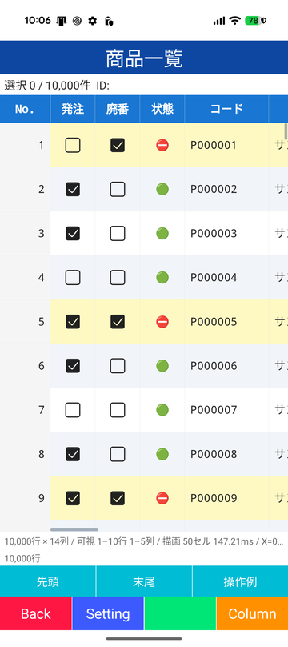
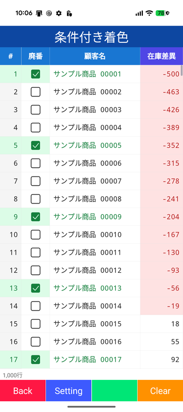
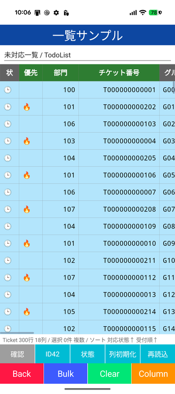

# ClamGrid - Grid view for .NET MAUI Android

[](https://www.nuget.org/packages/ClamGrid/)

## 🐚 What is this?

A .NET MAUI grid view for Android that draws cells with SkiaSharp.  
Layout, sorting, selection and touch handling run in C#, so the grid stays responsive with tens of thousands of rows.  

| 🖱 Selection, sorting and boolean editing | 🎨 Conditional colors | 🧾 Columns declared in XAML |
|:-:|:-:|:-:|
|  |  |  |

## 🚀 Quick Start

Call `UseSkiaSharp()` when building the application.  

```csharp
var builder = MauiApp.CreateBuilder()
    .UseMauiApp<App>()
    .UseSkiaSharp();
```

Define columns with typed value accessors and connect a data view.  

```csharp
var grid = new ClamGridView();
grid.ColumnDefinitions.ReplaceAll(
[
    new GridColumn("name", "Name", new GridValueAccessor<Customer, string>(static x => x.Name)) { Width = GridColumnWidth.Star(), MinWidth = 120 },
    new GridColumn("number", "Number", new GridValueAccessor<Customer, int>(static x => x.Number)) { Width = GridColumnWidth.Absolute(160), Alignment = TextAlignment.End, Format = "N0" },
    new GridColumn("done", "Done", new GridValueAccessor<Customer, bool>(static x => x.IsDone, static (x, value) => x.IsDone = value)) { IsBoolean = true, IsReadOnly = false }
]);

// Customer.Id is a unique and immutable key
var view = new GridDataView<Customer>(customers, static x => x.Id);
view.RegisterSort("name", static x => x.Name, StringComparer.CurrentCulture);
view.RegisterSort("number", static x => x.Number, StringComparer.Ordinal);

grid.ItemsSource = view;
grid.SelectionMode = GridSelectionMode.MultipleToggle;
grid.CellTapped += (_, e) => Debug.WriteLine(e.Hit);
```

Columns can also be declared in XAML.  
A column without `ValueAccessor` is resolved by `Key` from `ValueAccessors`, so the value access stays typed.  

```xml
<clam:ClamGridView ItemsSource="{Binding Customers}"
                   ValueAccessors="{x:Static local:Customer.Accessors}"
                   ColumnStates="{Binding ColumnStates}"
                   SelectionMode="MultipleToggle">
    <clam:GridColumn Key="name" Header="Name" Width="*" MinWidth="120" />
    <clam:GridColumn Key="number" Header="Number" Width="160" Alignment="End" Format="N0" />
    <clam:GridColumn Key="done" Header="Done" IsBoolean="True" IsReadOnly="False" />
</clam:ClamGridView>
```

```csharp
// Customer.Accessors
public static GridValueAccessorCollection<Customer> Accessors { get; } = new()
{
    { "name", static x => x.Name },
    { "number", static x => x.Number },
    { "done", static x => x.IsDone, static (x, value) => x.IsDone = value }
};
```

The grid scrolls by itself, so give it a definite size such as a `*` row of a `Grid`.  
Tap a header to sort, tap a row to select it and long press to select or clear all rows.  

## 🔗 Binding and MVVM

Every setting a view model needs is a bindable property or a command.  
`Example/Modules/Ticket` is a complete screen built this way.  

```xml
<clam:ClamGridView ItemsSource="{Binding Items}"
                   ValueAccessors="{x:Static models:TicketRowAccessors.Ticket}"
                   ColumnStates="{Binding ColumnStates}"
                   SortOrders="{Binding SortOrders}"
                   SelectedKeys="{Binding SelectedKeys}"
                   FrozenColumnCount="1"
                   GridStyle="{StaticResource ListGridStyle}"
                   SelectionMode="MultipleToggle"
                   SelectAllCommand="{Binding SelectCommand}"
                   ColumnConfigurationCommand="{Binding ColumnEditCommand}">
    <clam:GridColumn Key="StatusMark" Header="Status" Width="45" AllowSorting="False" />
    <clam:GridColumn Key="ReceiptOrder" Header="Order" Width="95" Format="D6" />
    <clam:GridColumn Key="StartedDate" Header="Started" Width="80" Format="MM/dd" />
</clam:ClamGridView>
```

```csharp
public sealed class TicketListViewModel : ObservableObject
{
    private readonly IColumnSettingsStore store;

    // Rows, selection and sort state in one object
    public GridDataView<TicketRow> Items { get; } = new(Array.Empty<TicketRow>(), static x => x.Id);

    // TwoWay bound: the grid writes the normalized orders and dragged widths back, so persisting them in the setter is enough
    public IReadOnlyList<GridColumnState>? ColumnStates
    {
        get;
        set
        {
            field = value;
            OnPropertyChanged();
            if (value is not null)
            {
                store.Save("columns", value);
            }
        }
    }

    // TwoWay bound as well: the grid writes the applied sort back after a header tap
    public IReadOnlyList<GridSortOrder>? SortOrders
    {
        get;
        set
        {
            field = value;
            OnPropertyChanged();
        }
    }

    // TwoWay bound keys of the selected rows; assigning them selects the rows, and they survive a reload of the rows
    public IReadOnlyList<object>? SelectedKeys
    {
        get;
        set
        {
            field = value;
            OnPropertyChanged();
        }
    }

    public ICommand SelectCommand { get; }

    public ICommand ColumnEditCommand { get; }

    public TicketListViewModel(IColumnSettingsStore store)
    {
        this.store = store;
        ColumnStates = store.Load("columns");
        SortOrders = [new GridSortOrder("ReceiptOrder")];
        Items.RegisterSort("ReceiptOrder", static x => x.ReceiptOrder);
        // Long press on a row: true selects, false clears
        SelectCommand = new Command<bool>(select => Items.UpdateSelection(x => select && !x.IsCompleted));
        // Long press on a header: open a settings page with an editable copy, assign session.Export() to ColumnStates on return
        ColumnEditCommand = new Command<GridColumnConfigurationEventArgs>(e => OpenColumnSettings(e.CreateEditSession()));
    }
}
```

| Task | Binding |
|---|---|
| Rows | `ItemsSource` bound to a `GridDataView<T>`, which owns rows, filter, selection and sort state |
| Columns | `GridColumn` children in XAML and `ValueAccessors` bound to a static `GridValueAccessorCollection<T>` |
| Column settings | `ColumnStates` (TwoWay, dragged widths included) and `ColumnConfigurationCommand`, whose argument creates the edit session for a settings page |
| Sort state | `SortOrders` (TwoWay) with the keys registered on the data view, and `SortCycle` for the header tap sequence |
| Selection | `SelectionMode`, `SelectedKeys` (TwoWay), `SelectAllCommand` and the selection methods of the data view |
| Editing | `IsReadOnly` and `CellValueChangedCommand` for boolean cells |
| Colors | `GridStyle` as a resource with `RowBackground` and the color callbacks |
| Other input | `CellTappedCommand`, `CellLongPressedCommand`, `ColumnWidthChangedCommand` and `RowMovedCommand` |

Messaging, navigation and screen controllers belong to the application.  

## ✅ Supported features

| Category | Detail |
|---|---|
| **Columns** | Auto / Absolute / Star width, minimum width, alignment, multi-line headers and cells with vertical alignment, format string and value converter, frozen leading columns, static header and cell colors, cell painter for custom drawing such as sparklines |
| **Column settings** | Visibility, order and saved widths, edit session for a settings screen, drag to resize |
| **Data** | `INotifyCollectionChanged` / `INotifyPropertyChanged` tracking, stable row keys, filtering |
| **Sorting** | Multi-key sort with history, direction aware comparers, sort callback, configurable tap cycle |
| **Selection** | None / single / multiple toggle, select all, selection by key, two way bound keys that select the rows again after a reload |
| **Editing** | Boolean cell toggle |
| **Row dragging** | Reorder rows by dragging the row header |
| **Input** | Tap, long press, pan with inertia, column resize, scrolling a row to a position, commands for MVVM |
| **Styling** | Font, padding, colors, alternating rows, grid lines by direction and width, sort marks, row header text, scroll bars, text for the empty state and conditional color callbacks |
| **Fonts** | Per character fallback to the `FallbackFonts` typefaces of SkiaExtension and system fonts, emoji sequences included |
| **Geometry** | `BodyBounds` and `GetCellBounds` / `GetColumnHeaderBounds` / `GetRowHeaderBounds` by index or column key, for placing views of your own over the grid |
| **Performance** | Judged by the p95 of the draw time staying within 16 ms; fps is not used and no extra margin is added for slower devices |

## 🧵 Threading

The grid must be used on the UI thread, and a `GridDataView<T>` on the thread that created it, which in practice is the same thread.  
Setting properties, calling methods and changing the bound collection all have to happen there; the members that change the grid or the data view check this and throw `InvalidOperationException` at once instead of leaving them in a state that breaks later.  

```csharp
var rows = await LoadRowsAsync();
await MainThread.InvokeOnMainThreadAsync(() => view.SetSource(rows));
```

A change made from inside one of the data view events is refused as well, so make it after the notification returns.  
`Suspend()` and `Resume()` of the data view fold a long series of changes into one rebuild.  

## 📖 API

See the [API reference](Document/API.md).  

## 🌊 Clam family

- [ClamCalendar](https://github.com/usausa/clam-calendar) - Calendar view
- [ClamChart](https://github.com/usausa/clam-chart) - Charts
- [ClamGauge](https://github.com/usausa/clam-gauge) - Circular gauge
- [ClamGrid](https://github.com/usausa/clam-grid) - Grid view
